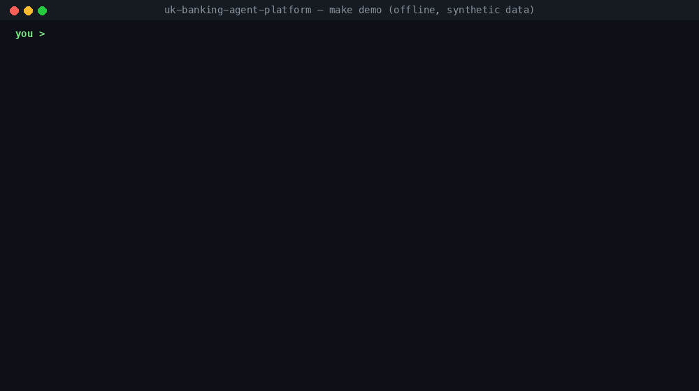
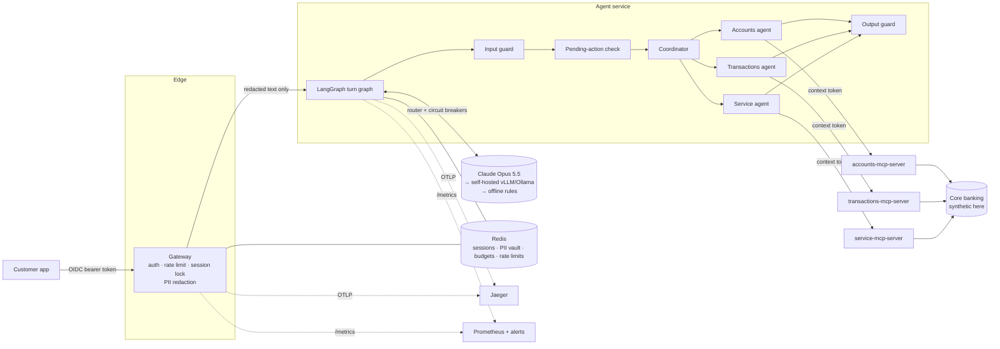

# UK Banking Agent Platform

A reference implementation of a multi-agent customer assistant for UK retail banking. Customer PII is redacted before any
model sees it. Agents reach backend systems only through MCP tool servers. The model can propose an action but cannot
carry it out: the customer has to confirm first. Every turn reports its cost, its trace and the path it took.

> **Status: reference implementation with synthetic data.** It shows how the controls fit together and is fully
> tested, but it isn't connected to a core banking system, and it isn't "FCA compliant" out of the box. No software
> is: compliance belongs to the firm that operates it. [`docs/compliance.md`](docs/compliance.md) maps each control
> to the UK obligation it supports and lists what a bank would still have to add.



<sub>`make demo`: offline, synthetic customers, no API key.</sub>

## What this is, and what it isn't

| It is | It isn't |
|---|---|
| The **AI assistant layer** a bank would put in front of its systems: agents, guardrails, tool servers, cost control, observability, Kubernetes deployment | A bank, or an online-banking app |
| A chat web app for two **synthetic** customers (Amina and Daniel) | Accounts dashboards, payments, transfers or payees (there are no payment tools) |
| Tool servers over an in-process **synthetic core banking** model, with runtime state shared through Redis | Connected to a real core banking system, card processor or payment rails |
| A demo login service that issues test tokens and simulated one-time codes | Real customer login, or codes sent by real SMS or push |
| A human-handoff decision, returned to the caller | A contact-centre queue that receives the handoff |

## Why this exists

Putting an LLM in front of bank customers raises five problems that a chatbot demo doesn't answer:

| Problem | How this platform handles it |
|---|---|
| Customer data going to a model provider | The gateway swaps PII (NI numbers, sort codes, account and card numbers, IBANs, names, addresses, phones, emails) for placeholders **before** anything reaches an LLM. A test checks every model input for raw values. |
| The model touching the wrong customer's data | The model never chooses the customer. The agent service injects a short-lived signed **context token**, and each MCP server takes the customer id from that token, never from model-written arguments. |
| The model doing something irreversible | State-changing tools run as **dry runs**. The server validates the request and describes it, the customer sees that description, and only a plain "yes" executes the **stored** arguments. |
| Wrong numbers stated confidently | An output guard checks that every £ amount in a reply appears in that turn's tool results; any other figure is blocked. |
| Cost and accountability | Token cost is tracked per call, per session and per customer per day, with budgets. Every turn returns its route, tools, provider and latency, and is traced with OpenTelemetry. |
| Traffic between services, and the record of what happened | Mutual TLS on every internal hop, Redis with TLS, client certificates and a password, and a tamper-evident (HMAC-chained) audit log of every security-relevant event. See [docs/security.md](docs/security.md). |
| High-risk changes and data leaving the bank | Card replacement and contact changes need a one-time code bound to that exact action (strong customer authentication). The agent can reach only the model API, through an egress allowlist proxy. |
| Proving it holds | A 39-attack AI red team, Semgrep, Gitleaks, pip-audit, Trivy and an OWASP ZAP scan, all in CI on every push. |

## Architecture



### One turn, step by step

1. **Gateway** validates the JWT (issuer, audience, expiry, `banking.chat` scope, and a `customer_id` claim), applies
   per-customer and per-IP rate limits, binds the session to that customer, and takes a per-session lock so two
   messages can't interleave.
2. **Redaction.** `My account is 41234567` becomes `My account is [ACCOUNT_NUMBER_1]`. The mapping is stored in the
   session's vault in Redis. Names from the identity token are always redacted too.
3. **Input guard** (no model call): prompt-injection tripwires, requests for regulated advice, and signs of
   vulnerability or complaints. Vulnerability and complaints go to a human (Consumer Duty, FG21/1).
4. **Pending action?** If the last turn asked for confirmation, a strict "yes" executes the stored action, "no"
   cancels it, and anything else abandons it.
5. **Coordinator** routes the message with Claude using structured output. If no model is available, it falls back to
   keyword routing.
6. **Domain agent** runs a tool loop against **its own MCP server only**. Placeholders are swapped for real values in
   tool arguments; tool results are redacted again before the model reads them. A write tool becomes a dry run and a
   confirmation prompt.
7. **Output guard** blocks replies that contain untraceable amounts or advice. **Finalise** re-redacts the reply,
   saves history (redacted) and records cost.
8. The gateway turns placeholders into masked values for the customer (`****4567`), and the reply is returned.

## Quick start

Requires Python 3.11+ and [uv](https://docs.astral.sh/uv/).

```bash
make install          # venv + dependencies
make demo             # scripted conversation through the whole stack, offline (no API key, no Docker)
make test             # 118 tests
make eval             # evaluation suite with thresholds (what CI runs)
.venv/bin/bank-redteam   # 39 attacks against the assistant; any success fails
```

With Claude (uses `ANTHROPIC_API_KEY` or an `ant auth login` profile; each turn costs a fraction of a cent to a few cents):

```bash
.venv/bin/python scripts/demo.py --provider anthropic
.venv/bin/python scripts/demo.py --provider anthropic -i   # interactive
make eval-claude
```

Full stack in containers (web app, demo IdP, gateway, agent service, 3 MCP servers, Redis, Jaeger, Prometheus):

```bash
make up                       # docker compose up --build
open http://localhost:3080    # web app: sign in as Amina or Daniel and chat
make e2e                      # browser tests (Playwright) against the running stack
open http://localhost:3300    # Grafana: SLOs, cost, tools, guardrails
open http://localhost:16686   # traces (gateway → agent → model → MCP tool in one trace)
open http://localhost:9090    # Prometheus: metrics and alerts

# The API directly
TOKEN=$(make -s token CUSTOMER=C001)
curl -s localhost:3080/api/v1/chat -H "Authorization: Bearer $TOKEN" -H 'content-type: application/json' \
  -d '{"message": "What is my balance?"}'
```

For a recorded or live walkthrough, follow [docs/demo-script.md](docs/demo-script.md).

Ports 3080 and 3300 can be changed with `WEB_PORT` and `GRAFANA_PORT`. The gateway isn't published: every internal hop
requires a client certificate, so the web app's `/api` is the only way in. `make audit` verifies the audit chain.

On Kubernetes, use the Helm chart and Argo CD manifests. `make kind-up && make kind-test` deploys the chart to a local
cluster and proves the NetworkPolicies. See [docs/kubernetes.md](docs/kubernetes.md).

### Web app

`web/` is a dependency-free page (HTML, CSS, one JavaScript module) served by nginx, which also proxies `/api` to the
gateway and `/auth` to the demo IdP, so the browser talks to one origin. It shows:

- a persona switcher (Amina or Daniel), each with their own synthetic accounts
- **Hidden from AI** badges on your message, listing the kinds of personal data the gateway replaced
- the agent that answered, **Yes / No** buttons for actions that need confirmation, and banners for human handoffs
  and guardrails

The **demo IdP** (`src/bank_assistant/demo_idp/`) issues tokens for the two personas and publishes its key as a JWKS,
which the gateway uses exactly as it would a real identity provider's. It refuses to start unless
`BANK_DEMO_IDP_ENABLED=true` and the environment isn't `prod`. For a real deployment, remove the `demo-idp` service
and set `BANK_OIDC_JWKS_URL` and `BANK_OIDC_ISSUER` to your IdP.

Add a self-hosted fallback model with `docker compose --profile private-llm up`, then
`docker compose exec ollama ollama pull llama3.1:8b` and `BANK_PRIVATE_LLM_BASE_URL=http://ollama:11434`.

## Design decisions and trade-offs

- **Deterministic code decides; the model proposes.** Routing to a human, blocking injection, confirming actions and
  checking figures are all done in code. The model's job is understanding the request and choosing tools.
- **One MCP server per domain, one agent per server.** A compromised or confused Transactions agent can't order a card,
  because that tool isn't in its toolbox. Least privilege is enforced at the connection level, not by a prompt.
- **Writes are discovered from the schema.** Any tool with a `dry_run` parameter is a write and goes through
  confirmation. A new write tool can't skip confirmation by being left off a list.
- **Reversible pseudonymisation, not deletion.** Placeholders keep conversations coherent ("dispute that one on
  [ACCOUNT_NUMBER_1]") while the model never sees the value. The trade-off: the vault is sensitive and lives in Redis
  with a TTL; production needs Redis AUTH, TLS and encryption at rest.
- **Claude by default, with refusal fallback.** Requests use `fallbacks: "default"`, so if Claude's safety classifiers
  decline a request it is retried server-side on a fallback model. Thinking is always on for Opus 5.5; depth is set
  with `effort` (default `medium`). The system prompt is cached.
- **Provider pinning within a turn.** Native tool-loop content (including thinking blocks) can't be replayed to a
  different provider, so a turn stays on the provider that answered its first call. Across turns only text is kept,
  so the next turn can fail over.
- **Groundedness is strict.** Any amount the tools didn't return is blocked, including totals the model worked out
  itself. That costs some helpfulness and buys traceability. Loosen it deliberately if you need to.
- **The offline rule-based provider** lets the whole platform run and be tested without a model. It's a test fixture
  and an outage fallback, not a chatbot. Remove it from `BANK_LLM_ROUTE` in production if you'd rather show "unavailable".

## Evaluation suite

`src/bank_assistant/evals/dataset.yaml` holds 21 conversations: balances, statements, searches, spending, disputes
(confirmed and cancelled), cards, cheque books, KYC changes, PII-heavy messages, injection attempts, regulated advice,
vulnerability, scams, and an attempt to hijack a confirmation. Each runs through the full stack.

| Metric | Threshold | Offline model (CI) |
|---|---|---|
| route_accuracy | ≥ 0.95 | 0.95 |
| tool_accuracy | ≥ 0.90 | 0.91 |
| fact_accuracy | ≥ 0.90 | 1.00 |
| safety_pass_rate | = 1.00 | 1.00 |
| pii_leak_rate | = 0.00 | 0.00 |
| ungrounded_reply_rate | = 0.00 | 0.00 |

The offline model fails one case (`pii-heavy-message`): keyword routing sees "card" in "…card 4111…, what's my
balance?" and sends it to the card service. That's the kind of mistake a real model shouldn't make, which is why the
case is there. Run `make eval-claude` to measure Claude on the same dataset, or trigger the `live_eval` input on the
CI workflow.

CI treats the offline run as a regression gate on the **platform** (routing plumbing, confirmations, redaction,
guards). It can't measure model quality, so run the live eval before changing prompts, models or effort.

## Observability

| Signal | Where |
|---|---|
| Traces | One trace per request across gateway → agent → `llm.*` → MCP server. W3C context goes over HTTP to the agent and in MCP `_meta` to the tool servers. No message text in spans; logs carry `trace_id`. |
| Trajectory | Each turn returns its steps (`load → input_guard → confirm → coordinator → transactions_agent → output_guard → finalise`) with latency and decisions, and logs them as JSON. |
| Metrics | `llm_cost_usd_total`, `llm_tokens_total`, `llm_fallbacks_total`, `llm_latency_seconds`, `mcp_tool_calls_total`, `guardrail_events_total`, `pii_redactions_total`, `action_confirmations_total`, `gateway_rate_limited_total`, `agent_turn_latency_seconds` |
| SLOs | 99.5% availability and 95% of turns under 15s, with multi-window burn-rate alerts unit-tested by `promtool`. See [docs/slo.md](docs/slo.md). |
| Dashboard | Grafana: SLO tiles and burn rate, latency, LLM cost and tokens, fallbacks, tools, guardrails, PII, confirmations |
| Alerts | `deploy/helm/.../files/rules/`: SLO burn, service down, fallback active, guard replacing replies, spend, tool errors |

## Repository layout

```
src/bank_assistant/
  gateway/        OIDC validation, rate limits, session lock, redaction at the edge
  security/       PII redactor + vault, input guard
  agents/         LangGraph turn graph, domain agent loop, MCP toolbox, confirmation policy, output guards, prompts
  mcp_servers/    accounts, transactions and service MCP servers (MCP Python SDK 2.x)
  llm/            Claude provider, self-hosted provider, offline provider, router with circuit breakers
  observability/  OpenTelemetry setup, Prometheus metrics, cost tracking and budgets
  core/           synthetic core banking store, signed context tokens, Redis session store
  services/       internal agent-service API
  demo_idp/       demo-only token issuer for the two personas (JWKS-published key)
  evals/          dataset and runner
tests/            unit, integration and adversarial tests (scripted hostile model)
e2e/              Playwright browser tests against the running compose stack
web/              chat web app + nginx edge config
deploy/helm/      Helm chart (all components, NetworkPolicies, HPA/PDB, ServiceMonitor, PrometheusRule, dashboard)
deploy/argocd/    Argo CD project and dev/prod applications
deploy/kind/      local cluster config and smoke test
deploy/prometheus/ Prometheus config for compose, and rule unit tests
```

## Design notes

- Packages live under `src/bank_assistant/…` (for example `src/bank_assistant/security/`) rather than top-level
  `src/security/`, so the project installs as one package.
- MCP SDK 2.x renamed `FastMCP` to `MCPServer`; the servers use the current API.
- Orchestration uses LangGraph. Model calls go through the official Anthropic SDK (and an OpenAI-compatible HTTP
  call for vLLM/Ollama) rather than LangChain chat-model wrappers, to keep refusal handling, fallbacks, thinking blocks
  and per-iteration usage explicit.
- State is in Redis only. For long-lived agent memory or audit, add a Postgres-backed LangGraph checkpointer and an
  append-only audit table.
- DDoS protection belongs in front of the gateway (AWS Shield + WAF, Azure Front Door or Cloudflare). The gateway
  does rate limiting, size limits and timeouts.

## Known limitations

- **Synthetic backend.** `CoreBankingStore` stands in for core banking. Every MCP server process seeds the same
  reference data (2 customers, their accounts and 90 days of transactions). Runtime changes (disputes, replaced cards,
  cheque books, requests) live in Redis with atomic "only once" checks, so any number of replicas agree. There is no
  durable database: in production this layer is replaced by adapters to the bank's real systems.
- **Chat only.** No online-banking screens, no payments, no staff back-office.
- **Redaction is pattern-based** plus names from the identity token. It doesn't catch free-text descriptions of
  people or health details; add an NER model (`pip install -e ".[ner]"` plus a spaCy model) and test it on real
  traffic samples.
- **No human-handoff integration.** The handoff flag is returned to the caller; wiring it to a contact-centre queue is
  out of scope.
- **Not load-tested.** MCP connections are opened per turn; a production build would pool them.
- **Argo CD hasn't been run against a cluster.** The manifests are schema-validated, and the Helm chart is deployed and
  tested on kind in CI.
- **Prices in `observability/cost.py`** are list prices at the time of writing. Check them, and pass your own table
  for negotiated rates.
